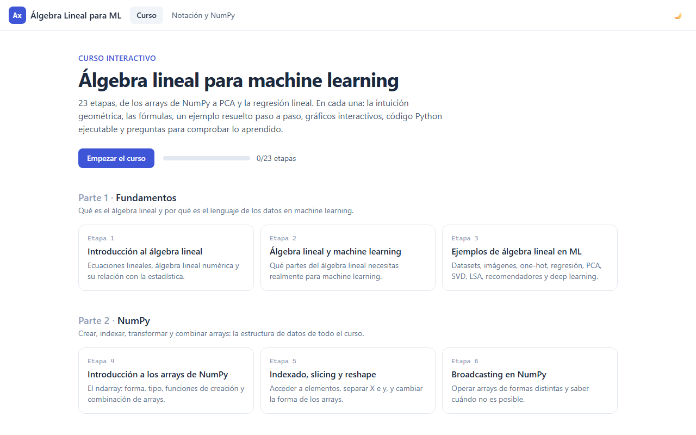
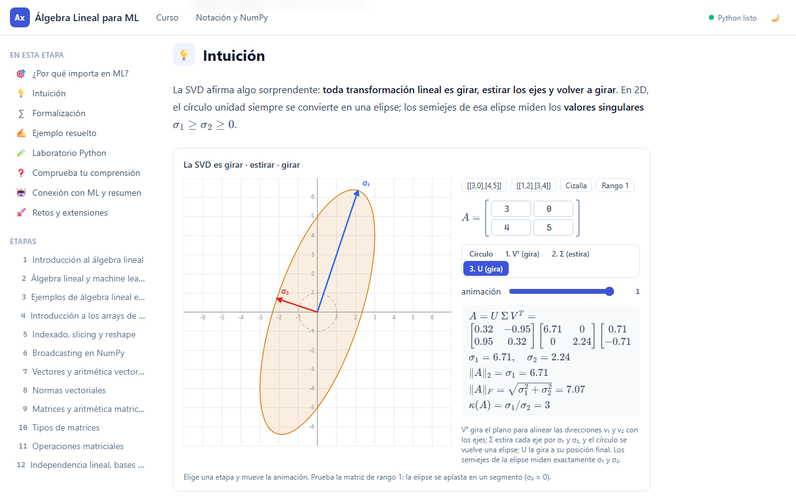
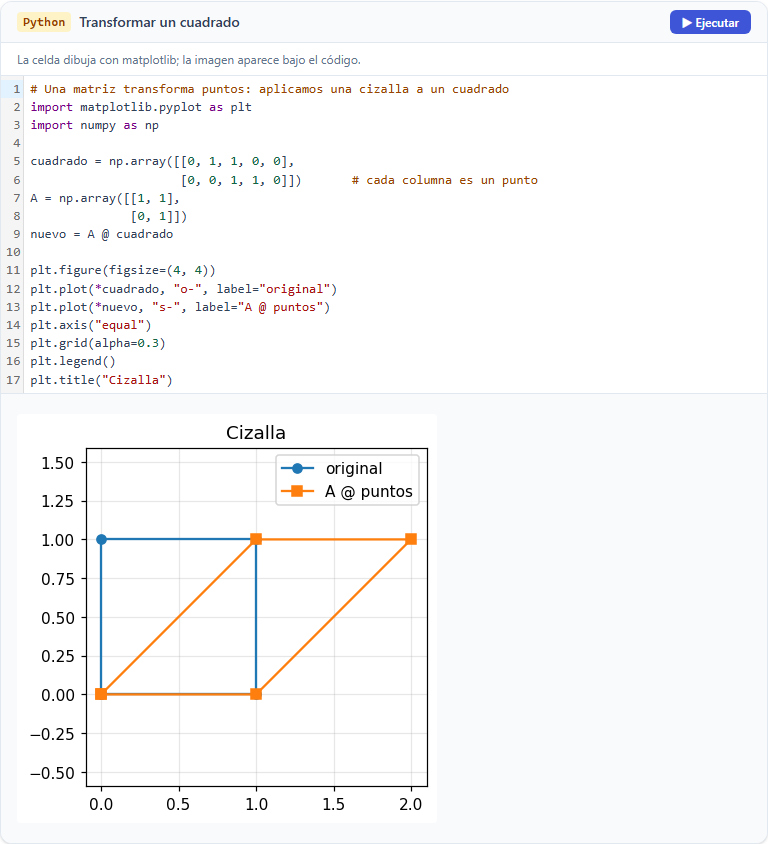

# Álgebra lineal para machine learning

**Curso interactivo y autocontenido, en español, que enseña el álgebra lineal que hace falta para entender machine learning.** Cada concepto se presenta con su intuición geométrica, su formalización matemática, un ejemplo resuelto a mano, gráficos manipulables, código Python ejecutable en el propio navegador y preguntas de autoevaluación.

El curso se organiza en 21 **etapas** agrupadas en cinco partes, desde los arrays de NumPy hasta PCA y la regresión lineal.



## Contenido

- [Características](#características)
- [Temario](#temario)
- [Inicio rápido](#inicio-rápido)
- [Comandos](#comandos)
- [Pruebas y garantías de calidad](#pruebas-y-garantías-de-calidad)
- [Arquitectura](#arquitectura)
- [Guía para autores](#guía-para-autores)
- [Solución de problemas](#solución-de-problemas)
- [Créditos](#créditos)

## Características

**Una plantilla pedagógica común.** Las 21 etapas tienen las mismas secciones, en este orden:

| Sección | Qué aporta |
| --- | --- |
| ¿Por qué importa en ML? | Motivación con un caso real de machine learning |
| Intuición | Explicación geométrica apoyada en visualizaciones interactivas |
| Formalización | Definiciones y fórmulas; **cada fórmula indica cómo se lee** y explica sus símbolos |
| Ejemplo resuelto | Cálculo a mano con pasos que se revelan uno a uno |
| Laboratorio Python | Celdas editables y ejecutables en el navegador |
| Comprueba tu comprensión | Preguntas de opción múltiple, numéricas y de matrices, con explicación |
| Conexión con ML y resumen | Aplicación práctica e ideas clave |
| Retos y extensiones | Ejercicios abiertos para profundizar |

**Visualizaciones interactivas.** 30 componentes propios en SVG: vectores arrastrables, transformaciones del plano, span y cambio de base, espacio columna y núcleo, la regresión como proyección en 3D, eliminación gaussiana paso a paso, Gram-Schmidt, búsqueda de vectores propios, la SVD como "girar · estirar · girar", compresión de imágenes, PCA como dirección de máxima varianza, mínimos cuadrados con los residuos al cuadrado dibujados, y más.



**Python real en el navegador.** Las celdas se ejecutan con [Pyodide](https://pyodide.org) (CPython compilado a WebAssembly) dentro de un Web Worker, sin servidor. Los paquetes se cargan bajo demanda según los `import` de cada celda: NumPy, SciPy, scikit-learn, SymPy, pandas y matplotlib (los gráficos se muestran bajo la celda).

<p align="center"></p>

**Notación siempre explicada.** Bajo cada fórmula, un bloque «Notación» aclara automáticamente sus símbolos: ℝⁿ («vectores de n componentes reales»), ∈, ∑, ‖·‖, ᵀ, ⁻¹, λ, Σ, 𝔼, arg min… La página **Notación y NumPy** reúne el glosario completo con buscador, el alfabeto griego usado en ML y una hoja de referencia de NumPy.

**Progreso guardado.** Una etapa se completa con el 70 % de aciertos en sus preguntas. El progreso se guarda en el navegador (`localStorage`). Incluye modo claro y oscuro.

## Temario

| Parte | Etapa | Visualizaciones principales |
| --- | --- | --- |
| **I. Fundamentos** | 1 · Introducción al álgebra lineal | Sistemas de ecuaciones como rectas que se cortan |
| | 2 · Álgebra lineal y machine learning | Mapa de las cinco áreas clave |
| | 3 · Ejemplos de álgebra lineal en ML | Imagen como matriz, codificación one-hot |
| **II. NumPy** | 4 · Arrays de NumPy | `vstack` / `hstack` |
| | 5 · Indexado, slicing y reshape | Explorador de expresiones de índice, `reshape` animado |
| | 6 · Broadcasting | Regla de compatibilidad de formas paso a paso |
| **III. Matrices** | 7 · Vectores y aritmética vectorial | Suma y escalado de vectores, producto punto como proyección |
| | 8 · Normas vectoriales | Contornos y bolas unidad L¹, L² y L∞ |
| | 9 · Matrices y aritmética matricial | Producto matricial celda a celda, matriz como transformación |
| | 10 · Tipos de matrices | Galería con propiedades comprobadas en vivo |
| | 11 · Operaciones matriciales | Determinante como área, rango, inversa |
| | 12 · Independencia lineal, bases y rango | Span de dos vectores, cambio de base, espacio columna y núcleo |
| | 13 · Proyecciones ortogonales | La proyección como matriz, la regresión como proyección en ℝ³ |
| | 14 · Matrices dispersas | Formato CSR editable, memoria densa frente a dispersa |
| | 15 · Tensores | Tensor 3D en capas con indexado |
| **IV. Factorización** | 16 · LU, QR y Cholesky | Eliminación gaussiana paso a paso, Gram-Schmidt |
| | 17 · Eigendescomposición | Búsqueda interactiva de vectores propios, matrices definidas positivas |
| | 18 · SVD | Geometría de la SVD, compresión de imágenes |
| **V. Estadística** | 19 · Estadística multivariada | Covarianza como promedio de productos, elipse de covarianza |
| | 20 · PCA | Varianza de la proyección y error de reconstrucción |
| | 21 · Regresión lineal | Ajuste por mínimos cuadrados, la regresión como proyección |

En total: 21 etapas, 30 visualizaciones interactivas, 143 celdas de Python y 160 preguntas de autoevaluación.

## Inicio rápido

### Requisitos

- [uv](https://docs.astral.sh/uv/) para el proyecto Python (instala Python 3.12 si no lo tienes).
- [Node.js](https://nodejs.org) 20 o superior para el frontend.
- Conexión a internet la primera vez que se ejecuta una celda: Pyodide y sus paquetes se descargan de jsDelivr y quedan en la caché del navegador.

### Instalación y arranque

```bash
git clone https://github.com/joserodriguezc/linear_algebra.git
cd linear_algebra
uv sync                 # crea el entorno Python
uv run build-assets     # genera los datos de la etapa de SVD
uv run dev              # instala las dependencias de npm si faltan y abre la app
```

La app se abre en `http://localhost:5173`. Para servirla como sitio estático:

```bash
cd app
npm run build           # genera app/dist/
npm run preview
```

## Comandos

| Comando | Dónde | Descripción |
| --- | --- | --- |
| `uv run dev` | raíz | Arranca el servidor de desarrollo (Vite) |
| `uv run build-assets` | raíz | Genera `app/public/data/svd_image.json` (imagen y su SVD) |
| `uv run pytest` | raíz | Ejecuta con Python real todos los snippets del curso |
| `uv run check-snippets` | raíz | Lo mismo, como informe legible |
| `uv run ruff check` | raíz | Lint del código Python |
| `npm run dev` | `app/` | Servidor de desarrollo |
| `npm run build` | `app/` | Comprobación de tipos y build de producción |
| `npm test` | `app/` | Tests unitarios (Vitest) |
| `npm run test:e2e` | `app/` | Tests de extremo a extremo (Playwright) |
| `npm run lint` | `app/` | Lint del frontend (oxlint) |

## Pruebas y garantías de calidad

El contenido se valida automáticamente en cuatro niveles:

| Nivel | Herramienta | Qué comprueba |
| --- | --- | --- |
| Snippets | pytest | Cada celda del curso se ejecuta sin errores con NumPy/SciPy/scikit-learn reales; las que deben fallar a propósito llevan `# expect-error: TipoDeError` |
| Lógica | Vitest | Utilidades de álgebra lineal (LU, QR, SVD, eigen 2×2…), intérprete de índices de NumPy, motor de preguntas y glosario de notación |
| Contenido | Vitest | Cada etapa tiene todas las secciones de la plantilla; cada fórmula tiene su lectura; ℝ siempre se aclara como «números reales»; las preguntas están bien formadas |
| Extremo a extremo | Playwright | Todas las etapas cargan sin errores, el progreso persiste y **todas las celdas se ejecutan en Pyodide** (detecta diferencias entre el Python local y el del navegador) |

```bash
uv run pytest && cd app && npm test && npm run test:e2e
```

## Arquitectura

### Stack

| Capa | Tecnología |
| --- | --- |
| Interfaz | React 19, TypeScript, React Router (hash) |
| Contenido | MDX con `remark-math` y `rehype-katex` |
| Estilos | Tailwind CSS 4 con `@tailwindcss/typography` |
| Matemáticas | KaTeX |
| Gráficos | Componentes SVG propios, sin librerías de gráficos |
| Editor | CodeMirror 6 |
| Python en el navegador | Pyodide 314 en un Web Worker |
| Herramientas Python | uv, NumPy, SciPy, scikit-learn, SymPy, pandas, matplotlib, Pillow |
| Build y pruebas | Vite 8, Vitest, Playwright, pytest, Ruff, oxlint |

No hay backend: la app es un sitio estático y todo el cómputo ocurre en el navegador.

### Estructura del repositorio

```
.
├── app/                          Frontend (React + Vite)
│   ├── src/
│   │   ├── course/
│   │   │   ├── curriculum.ts     Partes y etapas en orden (el número de etapa sale de la posición)
│   │   │   ├── stages/           Una etapa por archivo: <slug>.mdx
│   │   │   ├── snippets/<slug>/  Código Python de cada etapa (.py, importado con ?raw)
│   │   │   └── quizzes/<slug>.ts Preguntas de cada etapa
│   │   ├── components/
│   │   │   ├── lesson/           Plantilla: Section, Formula, WorkedExample, Callout…
│   │   │   ├── code/             PyCell y el worker de Pyodide
│   │   │   ├── quiz/             Componente y motor de corrección
│   │   │   └── viz/              Visualizaciones interactivas
│   │   ├── lib/                  linalg.ts, ndindex.ts, notation.ts, progress.ts…
│   │   └── pages/                Inicio, etapa y referencia
│   ├── public/data/              Datos generados por build-assets
│   └── e2e/                      Tests de Playwright
├── tools/                        Comandos de uv: dev, build_assets, snippets
├── tests/                        pytest: validación de los snippets
└── pyproject.toml, uv.lock       Proyecto Python gestionado con uv
```

### Ejecución de las celdas de Python

```
PyCell (hilo principal)  ──código──▶  Web Worker
                                      ├─ carga Pyodide (una vez) desde jsDelivr
                                      ├─ loadPackagesFromImports(código)
                                      ├─ ejecuta en un espacio de nombres limpio
                                      └─ devuelve stdout, errores y figuras PNG
PyCell  ◀──salida en streaming──────  (cola de ejecución: una celda a la vez)
```

Python se ejecuta fuera del hilo de la interfaz, así que una celda lenta no bloquea la página; el botón **Detener** reinicia el intérprete. Cada celda corre en un espacio de nombres propio: los ejemplos son autocontenidos.

## Guía para autores

Cada etapa se identifica por su **slug** (por ejemplo, `pca`): nombra sus archivos, su URL y su progreso guardado. Su número no se escribe en ningún sitio, sino que se calcula a partir de su posición en `curriculum.ts`. Así, insertar o reordenar etapas no obliga a renumerar nada.

Para añadir o modificar una etapa:

1. **Metadatos**: registra la etapa en `app/src/course/curriculum.ts`, en la posición que le corresponda.
2. **Código**: crea los snippets en `app/src/course/snippets/<slug>/*.py`. Deben ser autocontenidos. Si uno debe fallar a propósito, añade `# expect-error: ValueError`.
3. **Preguntas**: escríbelas en `app/src/course/quizzes/<slug>.ts` (`choice`, `numeric` o `matrix`). Los textos admiten LaTeX en línea entre `$…$`.
4. **Contenido**: crea `app/src/course/stages/<slug>.mdx` con las secciones de la plantilla (`<Section kind="why|intuition|formal|example|lab|quiz|ml|extensions">`). Los componentes del curso están disponibles sin importarlos; `<Quiz questions={quiz} />` sabe solo a qué etapa pertenece.
5. **Verificación**: ejecuta `uv run pytest`, `npm test` y `npm run test:e2e`.

Convenciones que los tests hacen cumplir:

- Las fórmulas de la formalización se escriben con `<Formula tex="…" reading="…">`. La lectura aparece precedida de «Esta fórmula se lee:».
- Si una fórmula usa un símbolo que el glosario aún no conoce, se añade una regla en `app/src/lib/notation.ts` con su test.
- Si ℝ aparece fuera de una fórmula, la misma línea debe aclarar que son los números reales.
- En los ejemplos resueltos, el enunciado va en `<Problem>` y cada paso en un `<Step>`.
- Para citar otra etapa se usa `<StageRef slug="pca" />`, que muestra el número actual y enlaza; nunca se escribe «etapa 20» a mano.
- Las fórmulas en bloque se escriben con `$$` en líneas propias (en una sola línea, remark-math las muestra en línea).

```mdx
<Formula label="Producto punto" tex="a \cdot b = \sum_{i=1}^{n} a_i b_i"
  reading="a punto b es igual a la sumatoria, para i desde 1 hasta n, de a sub i por b sub i" />

<PyCell title="Producto punto" code={punto} hint="Qué observar en la salida." />
```

## Solución de problemas

| Síntoma | Causa y solución |
| --- | --- |
| Las celdas se quedan en «Descargando Python…» | Pyodide se descarga de jsDelivr: se necesita conexión la primera vez. |
| Vitest dice *failed to find the current suite* (Windows) | La ruta empieza por `c:\` en minúscula. Ejecútalo desde `C:\…`. |
| Una celda funciona en local pero no en el navegador | Pyodide trae otras versiones de los paquetes y otro LAPACK. `npm run test:e2e` lo detecta; ajusta el snippet para que funcione en ambos entornos. |
| La etapa de SVD indica que faltan los datos | Ejecuta `uv run build-assets`. |

## Créditos

- **Imagen de la etapa de SVD**: `china.jpg`, incluida en scikit-learn (`sklearn.datasets.load_sample_image`).
